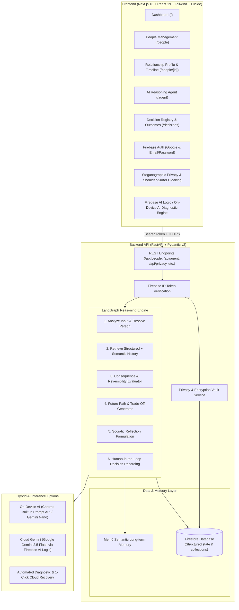

# Relationship Intelligence AI (Keeva)

[](file:///d:/projects/Keeva/LICENSE)
[](file:///d:/projects/Keeva/CONTRIBUTE.md)
[](https://nextjs.org/)
[](https://fastapi.tiangolo.com/)
[](https://www.python.org/)
[](https://www.docker.com/)

> **"Remember the relationship, not just the conversation."**

An external relationship memory, reasoning, and reflection web application designed to help humans navigate complex relationships.

Humans cannot perfectly remember years of interactions, conflicts, supportive experiences, communication patterns, and contexts. When tension or conflict arises, people often react based only on the immediate moment or raw emotional impulse. 

**Relationship Intelligence AI** surfaces accumulated relationship history, context-dependent patterns, and prospective consequences before an irreversible decision is made.

---

## Contributing & Open-Source

We welcome contributions! Please read our [CONTRIBUTE.md](file:///d:/projects/Keeva/CONTRIBUTE.md) for architectural guardrails, setup guides, coding standards, and PR workflows.

---

## Important Product Philosophy

**What this is NOT:**
- ❌ NOT an AI therapist, psychologist, dating coach, or relationship advisor.
- ❌ NOT a generic ChatGPT clone.
- ❌ NOT an AI that makes decisions for the user.
- ❌ NOT an AI that diagnoses people or claims to know another person's inner psyche.

**The Golden Distinction:**
- **Observation (Acceptable)**: *"Based on what you've recorded, Rahul became defensive during several political disagreements."*
- **Unsupported Claim (Unacceptable)**: *"Rahul is an aggressive person."*

> **"AI does not decide for me. AI helps me think before I decide."**

---

## Architecture Diagram



---

## Tech Stack

- **Frontend**: Next.js 16 (App Router), TypeScript Strict Mode, Tailwind CSS, Lucide Icons.
- **Authentication**: Firebase Authentication (Google Auth & Email/Password) + Dev/Demo Mode.
- **Structured Database**: Google Cloud Firestore (collections: `users`, `people`, `relationships`, `relationship_events`, `relationship_contexts`, `decisions`).
- **Semantic Long-Term Memory**: Mem0 (user-isolated vector observations and decision outcomes).
- **Reasoning Agent**: LangGraph (StateGraph with conditional interruption and checkpointing).
- **Backend API**: Python 3.11, FastAPI, Pydantic v2.
- **AI Inference**: Firebase AI Logic & Hybrid Inference (On-device Chrome Built-in AI with fallback to Cloud Gemini 2.5 Flash).
- **Deployment**: Vercel (Frontend) and Google Cloud Run (Backend via Docker).

---

## Steganographic Privacy & Shoulder-Surfer Cloaking Vault

When using Keeva in public environments (cafes, transit, open offices), onlookers glancing at the screen might see real names. The **Steganographic Privacy Vault** protects confidentiality by cloaking real names behind innocent codenames:

- **Preset Alias Categories**:
  - 🌍 **Countries**: *China*, *Japan*, *Norway*, *Brazil*, *Kenya*, *Greece*...
  - 🍎 **Fruits**: *Mango*, *Kiwi*, *Papaya*, *Avocado*, *Peach*, *Fig*...
  - 🐾 **Animals**: *Falcon*, *Otter*, *Fox*, *Panda*, *Koala*, *Penguin*...
  - ⚔️ **Anime**: *Goku*, *Luffy*, *Naruto*, *Levi*, *Zoro*, *Gojo*...
  - ✏️ **Custom**: Any user-chosen pseudonym.
- **Master PIN / Security Question**: Real names remain cloaked by default. Entering your Master PIN or answering your security question temporarily unlocks real identities.
- Learn more in [docs/privacy_layer.md](file:///d:/projects/Keeva/docs/privacy_layer.md).

---

## Hybrid AI Architecture & Inference Control

Keeva gives you explicit control over where and how your prompts are processed:

1. **⚡ Auto (Hybrid)** (*Recommended*): Uses on-device Gemini Nano if ready; smoothly falls back to Cloud Gemini without interruption.
2. **💻 On-Device Only**: Prompts run 100% locally in Chrome via the Prompt API (`window.ai`). Prompts never leave your computer.
3. **☁️ Cloud Gemini Only**: Direct cloud execution via Google Gemini 2.5 Flash on Firebase AI logic.

### Live Diagnostic Troubleshooting & 1-Click Fallback
If on-device mode is active but the local model cannot run, Keeva inspects your browser environment and presents a categorized `LocalAIErrorCard`:
- Pinpoints the exact cause (`Chrome Flag Disabled`, `Model Weights Downloading (~1.5 GB)`, `Hardware Requirement Blocked`, `Unsupported Browser`).
- Provides 1-click **Copy Link** buttons for `chrome://flags/#prompt-api`, `chrome://flags/#optimization-guide-on-device-model`, and `chrome://components`.
- Includes an instant **"Switch to Cloud Gemini & Proceed"** fallback that submits your pending prompt without retyping.
- Learn more in [docs/hybrid_ai.md](file:///d:/projects/Keeva/docs/hybrid_ai.md).

---

## Memory Architecture

```text
Firestore (Structured Application State)
├── people: name, relationshipType, duration, status, lastInteraction
├── relationship_events: timestamp, context, eventType, description, observedBehavior, outcome
├── relationship_contexts: context, patternObservation, emotionalIntensity
└── decisions: situation, proposedAction, futureBranches, reflection, finalDecision, outcome

Mem0 (Semantic Long-term Memory)
└── Scoped by user_id, person_id, context
    Stores unstructured semantic summaries, historical resolutions, and decision outcomes
```

---

## LangGraph State & Agent Workflow

```python
class RelationshipAgentState(TypedDict):
    user_id: str
    message: str
    person_id: str | None
    relationship_id: str | None
    emotional_intensity: float | None
    consequence_severity: float | None
    reversibility: str | None  # "high", "medium", "low"
    is_pause_warranted: bool
    relevant_memories: list
    relevant_events: list
    future_branches: list
    reflection_questions: list
    final_decision: str | None
    outcome: str | None
```

### Consequence Detection & "Take a Pause" Rule
When a user expresses a consequential or emotionally activated impulse:
- **Condition**: `emotional_intensity > 0.60` AND `consequence_severity > 0.65` AND `reversibility in ["low", "medium"]`.
- **Response**: Triggers an **AIPauseCard**, retrieves multi-year relationship history, generates 2–4 plausible future paths with trade-offs, poses 1–2 grounding reflection questions, and leaves the final decision in the user's hands.

---

## Firestore Schema & Security Rules

Security rules enforce strict user-level data isolation:
```javascript
rules_version = '2';
service cloud.firestore {
  match /databases/{database}/documents {
    match /people/{personId} {
      allow read, update, delete: if request.auth != null && resource.data.userId == request.auth.uid;
      allow create: if request.auth != null && request.resource.data.userId == request.auth.uid;
    }
    match /decisions/{decisionId} {
      allow read, update, delete: if request.auth != null && resource.data.userId == request.auth.uid;
      allow create: if request.auth != null && request.resource.data.userId == request.auth.uid;
    }
  }
}
```

---

## 30-Second Hackathon Demo Journey

1. Open the application at `http://localhost:3000`.
2. Click **"Load Demo History (Rahul · 8 yrs)"** in the top navigation or on the dashboard.
   - Pre-seeds Rahul (Friend, 8 years).
   - Seeds timeline: 2023 (helped during personal crisis), 2024 (politics conflict), 2025 (defensive interaction + 4-day communication pause + reconciliation), 2026 (communication frequency declined).
   - Seeds context observations: Politics (high friction), Personal Problems (supportive), Casual (positive).
   - Seeds Mem0 semantic memories.
3. Open the **AI Agent** tab (`/agent`).
4. Click the pre-populated test scenario button:
   > *"Rahul ignored me again. I'm done with this friendship."*
5. Witness the AI in action:
   - Identifies high consequence + low reversibility.
   - Triggers the **"Take a Pause"** card.
   - Surfaces what the user forgot: 8-year friendship, supportive in 2023, past 4-day pause reconciled.
   - Generates 3 plausible paths (e.g. Cut contact vs. Address after 48h vs. Take deliberate space).
   - Asks reflection questions: *"Which consequences are you actually willing to accept? The decision is yours."*
6. Select a path, write your reflection, and click **"Confirm My Decision"**.
7. Navigate to `/decisions` to view recorded decisions and log real-world outcomes that feed back into memory!

---

## Local Setup & Development

Detailed setup instructions, environment variable configurations, and contribution workflows can be found in [docs/setup.md](file:///d:/projects/Keeva/docs/setup.md) and [CONTRIBUTE.md](file:///d:/projects/Keeva/CONTRIBUTE.md).

### Quickstart with Docker Compose

```bash
# 1. Clone & enter repository
git clone https://github.com/your-org/keeva.git
cd keeva

# 2. Setup environment variables
cp .env.example .env

# 3. Start backend services
docker-compose up -d --build

# 4. Run frontend
cd frontend
npm install
npm run dev
```

Visit `http://localhost:3000` to launch the application.

---

### Manual Setup (Without Docker)

#### 1. Backend Setup (FastAPI)
```bash
cd backend
python -m venv venv
# On Windows:
.\venv\Scripts\activate
# On Linux/macOS:
source venv/bin/activate

pip install -r requirements.txt
uvicorn app.main:app --reload --port 8000
```
Backend API will be running at `http://localhost:8000` (interactive OpenAPI docs at `http://localhost:8000/docs`).

#### 2. Frontend Setup (Next.js 16)
```bash
cd frontend
npm install
npm run dev
```
Frontend will be running at `http://localhost:3000`.

---

## Running Automated Tests

Run the complete backend test suite:
```bash
cd backend
$env:PYTHONPATH="."
.\venv\Scripts\python -m tests.test_agent_consequence
```

---

## Security & Privacy

1. **Authentication**: Every backend endpoint verifies Firebase ID tokens. User ID is extracted server-side from the verified token and never trusted from frontend parameters.
2. **User Isolation**: All queries to Firestore and Mem0 are strictly scoped to `request.auth.uid`.
3. **No Secret Leaks**: Backend API keys (`GEMINI_API_KEY`, `MEM0_API_KEY`, Firebase service accounts) remain strictly on the backend.
4. **Data Deletion**: Users can delete any tracked person, timeline event, or semantic memory at any time.

---

## Roadmap

- [x] Multi-person relationship modeling and longitudinal timeline
- [x] Context-dependent pattern tracking (politics vs. personal vs. casual)
- [x] Natural language note extraction with user review & confirmation
- [x] Consequence detection & "Take a Pause" intervention
- [x] Plausible future scenarios & trade-off generation
- [x] Socratic reflection formulation
- [x] Human-in-the-Loop decision commitment
- [x] Longitudinal outcome tracking and feedback into Mem0
- [x] Dual-Tier Hybrid AI inference (On-Device Gemini Nano + Cloud Gemini 2.5 Flash)
- [x] Steganographic Privacy & Shoulder-Surfer Cloaking Vault (PIN & Security Questions)
- [x] Automated Chrome Prompt API flag & weights diagnostics with 1-click cloud fallback
- [ ] Multimodal interaction voice notes and audio journaling
- [ ] Calendar integration for natural reminder intervals (e.g., reconnect after planned space)

---

## Contributing

We welcome all contributions! Please check out [CONTRIBUTE.md](file:///d:/projects/Keeva/CONTRIBUTE.md) to get started with setup, PR templates, and ethical guardrails.

---

## License

MIT License. See [LICENSE](file:///d:/projects/Keeva/LICENSE) for details.
