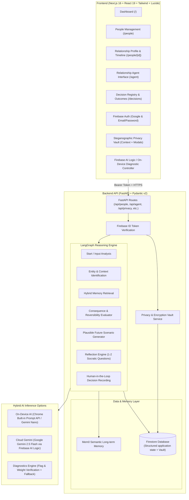

# Relationship Intelligence AI - Architecture

## Core Philosophy
> **"Remember the relationship, not just the conversation."**

Humans cannot perfectly retain years of interactions, conflicts, positive experiences, communication patterns, contexts, and long-term trajectory. Relationship Intelligence AI serves as an external relationship memory and reasoning system.

It is **NOT**:
- An AI therapist, psychologist, or relationship advisor.
- A generic chatbot or ChatGPT clone.
- An agent that makes decisions for the user or claims to objectively diagnose another person.

It **IS**:
- An observation-based relationship memory and reflection engine.
- A system that distinguishes between observations ("Rahul became defensive during several political disagreements") and unsupported claims ("Rahul is an aggressive person").
- A consequence-aware reasoning system that introduces a constructive **"Pause"** when high-consequence, low-reversibility actions are detected.

---

## High-Level System Architecture

---

## Data Model & Isolation
Every record in Firestore and Mem0 is strictly isolated by `userId`.

1. **Structured State (Firestore)**:
   - `users`: User settings, reflection preferences, and encrypted vault configuration.
   - `privacy_vaults`: Hashed PINs, security questions/answers, and default alias categories.
   - `people`: Tracked individuals (realName, assignedAlias, relationship type, duration, status, contexts).
   - `relationships`: Connection metadata and relationship status.
   - `relationship_events`: Chronological events (timestamp, context, eventType, userEmotion, observedBehavior, outcome).
   - `relationship_contexts`: Context-specific dynamics (e.g. politics -> defensive, personal problems -> supportive).
   - `decisions`: Deliberate pauses, situations, branches, reflections, decisions, and tracked outcomes.
   - `agent_sessions`: Multi-turn conversational sessions and checkpoint states.

2. **Semantic Long-term Memory (Mem0)**:
   - Vector-indexed observations, historical resolutions, and explicit user-recorded patterns.
   - User-scoped queries with person and context filters.

---

## Consequence Detection & "Pause" Flow
When a user expresses a consequential or emotionally charged impulse:
- **Signals**: `emotional_intensity > threshold` AND `consequence_severity > threshold` AND `reversibility == "low"`
- **Response**: The AI does not tell the user what to do. It surfaces relationship context, explores 2–4 plausible consequences across alternative paths, asks 1–2 grounding reflection questions, and leaves the final decision in the user's hands.
